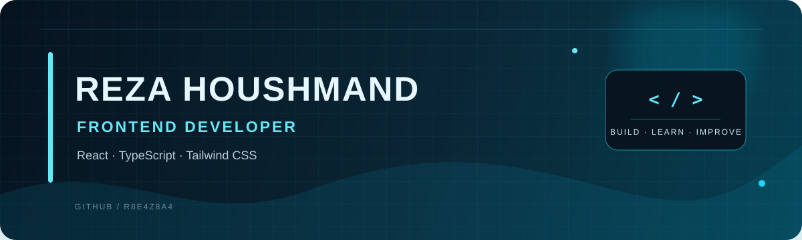
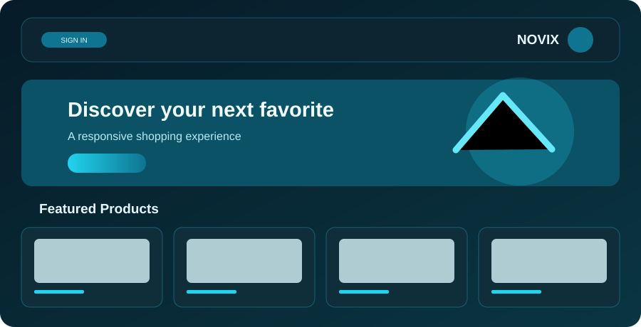
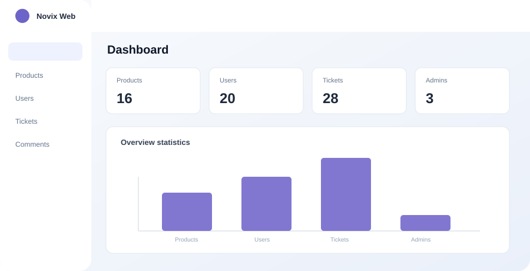

<!--
  GitHub Profile README
  Reza Houshmand | @r8e4z8a4
  Theme: Deep Navy + Cyan
-->

  
    
  
  
  
  
  

 

  

## About Me

I'm a frontend developer focused on building modern, responsive, and user-friendly web applications.

- Developing interactive interfaces with **React** and **JavaScript**
- Building responsive layouts with **Tailwind CSS**
- Connecting frontend applications to **REST APIs**
- Paying attention to clean code, maintainable structure, and user experience
- Currently learning **TypeScript** and applying it to my upcoming projects
- Always exploring better ways to build and improve real-world applications

> I take responsibility for frontend development and API integration in my featured projects. Backend development was handled separately.

## Tech Stack

**Currently working with**

  

**Currently learning**

  

## Featured Projects

### Online-Shop

A responsive e-commerce frontend built with React and Tailwind CSS, integrated with backend APIs.

**Highlights**
- Product categories, product details, and shopping cart
- Checkout and order placement flow
- User sign-up, sign-in, and authentication
- Address handling and map-based location features
- Responsive experience across desktop, tablet, and mobile

**Libraries:** React Router · Axios · React Leaflet · React Select · React Use · Sonner · Styled Components · Swiper · Zod · clsx · React Icons

  
  

---

### CMS-project

A responsive content management dashboard built with React and Tailwind CSS, connected to backend APIs.

**Highlights**
- Dashboard with key statistics and charts
- Product management
- User management
- Ticket management
- Comment management
- Responsive admin interface

**Libraries:** React Router · Recharts · React Loader Spinner · React Icons · clsx

  
  

## GitHub Analytics

  
  
    
  

## Contribution Activity

  
   
  

## Let's Connect

I'm open to connecting with developers, exchanging ideas, and learning through building real projects.

  
  
  
  

   
  
  Designed and built by Reza Houshmand

